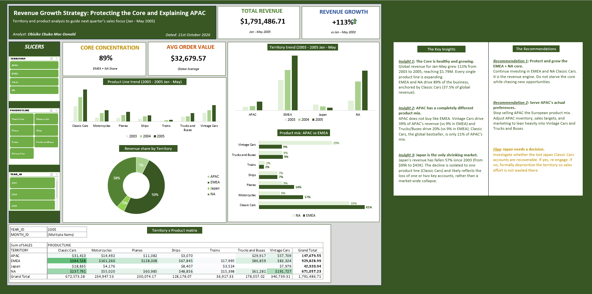
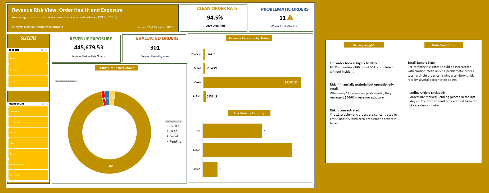

# Global Sales Business Intelligence Project (2003 to 2005)

**Analyst:** Ebuka Mac-Donald Obisike  
**Role Target:** Business Intelligence Analyst  
**Tools Used:** Excel (Power Query, PivotTables, Data Modeling, Dashboard Design)

## 📌 Project Overview
The goal of this project was to act as a Business Intelligence Analyst for a global retail company. I was provided with a raw, messy dataset containing 2,823 sales line items across 307 distinct orders. 

The business needed answers to two specific questions:
1. **Growth:** Where should the sales team focus effort next quarter to grow revenue?
2. **Risk:** Where is revenue currently at risk?

To answer this, I followed a complete data lifecycle: Data Inspection, Data Cleaning, Exploratory Analysis, and Dashboard Visualization.

---

## 🖼️ The Dashboards

### 1. The Growth View (Revenue Expansion)

**My Thought Process & Insights:**
*   **The Core is Strong:** I found that EMEA and North America drive 89% of total revenue. Classic Cars alone make up 37.5% of the business and are growing rapidly. 
*   **The APAC Surprise:** When I analyzed the product mix by territory, I found that APAC buys completely differently than EMEA. While EMEA relies on Classic Cars, APAC is driven by Vintage Cars and Trucks. 
*   **Recommendation:** Protect and grow the EMEA/NA core, but pivot the APAC inventory, sales targets, and marketing to match their actual buying preferences.

### 2. The Risk View (Order Health)

**My Thought Process & Insights:**
*   **Operational Health:** I analyzed order statuses and found the pipeline is 94.5% clean. Only 11 out of 307 orders were problematic.
*   **Financial Exposure:** While the count of problematic orders is small, they represent $445,679 in revenue exposure (4.4% of total revenue). 
*   **Data Caveat:** I explicitly noted on the dashboard that while the financial exposure is material, the sample size of 11 problematic orders is too small to reliably rank territories by risk rate. I deliberately excluded "Pending" orders (from the last 3 days of the dataset) from the risk denominator so they wouldn't skew the rates.

---

## 🗂️ Repository Guide (The Data Lifecycle)
This repository is structured to show my complete workflow from raw data to final recommendations:

*   **01_Raw_Data.csv**: The original Kaggle dataset.
*   **02_Inspect_Phase_Report.pdf**: My initial data profiling document identifying missing values, duplicate risks, and data types.
*   **03_Data_Cleaning_Changelog.xlsx**: A detailed Excel log of every transformation made in Power Query. 
*   **04_Analysis_Summary.pdf**: The written business report outlining the findings, data limitations, and final recommendations.
*   **05_Business_Intelligence_Dashboard.xlsx**: The final workbook containing the raw data, cleaned data, PivotTables, interactive slicers, and the two dashboard tabs.
*   **/pictures**: Folder containing the dashboard screenshots used in this README.

---

## 🧹 Critical Data Cleaning Steps (Power Query)
I documented my cleaning process in a formal Changelog, but here are the major steps I took:
1.  **Dropped Unused/PII Columns:** Removed Address Line 2 (89% blank), State (53% blank), Phone, and Contact Names.
2.  **Standardized Text:** Applied TRIM and standardized casing to Territory, Country, Status, and Product Line.
3.  **The Sales Anomaly Investigation:** I noticed that in about 45% of the rows, the `Sales` column did not equal `Quantity x Price Each` (averaging +39% higher). I created diagnostic columns (`Variance %`, `Effective Price`) to test hypotheses. I ruled out MSRP pricing, product markups, and fixed fees. Because `Sales` is always positive and represents the actual transaction value, I retained it as the authoritative revenue measure and documented the limitation.
4.  **Status Grouping:** Created a `Status Group` column to map 6 raw statuses into 4 actionable categories (Clean, At Risk, Failed, Pending) for the Risk Dashboard.

---

## 📊 Analytical Techniques Demonstrated
*   **Time-Intelligence Filtering:** Because the dataset ends on May 31, 2005, raw yearly comparisons for 2005 would show an artificial decline. I applied a Jan-May filter to all trend charts to ensure 2003, 2004, and 2005 were compared equally.
*   **Distinct Count Logic:** Since one order contains multiple line items, I created a "First Occurrence Flag" helper column to accurately count distinct orders (307) rather than line items (2,823).
*   **Hypothesis Testing:** Used custom calculated columns to diagnose systemic data anomalies rather than just deleting "weird" rows.

## 🚀 Summary of Final Recommendations
1.  **Protect the Core:** Continue heavy investment in EMEA and NA Classic Cars.
2.  **Adapt to APAC:** Shift the APAC product strategy to prioritize Vintage Cars and Trucks.
3.  **Japan Decision:** Investigate the recent loss of key Classic Car accounts in Japan. If unrecoverable, deprioritize the territory to save sales effort.
